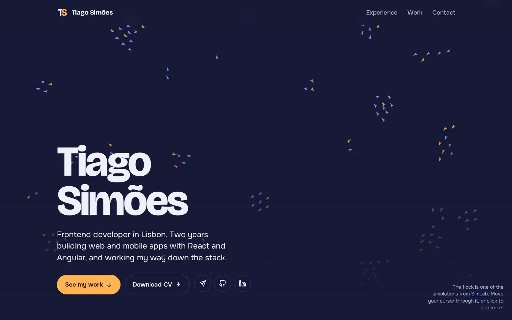
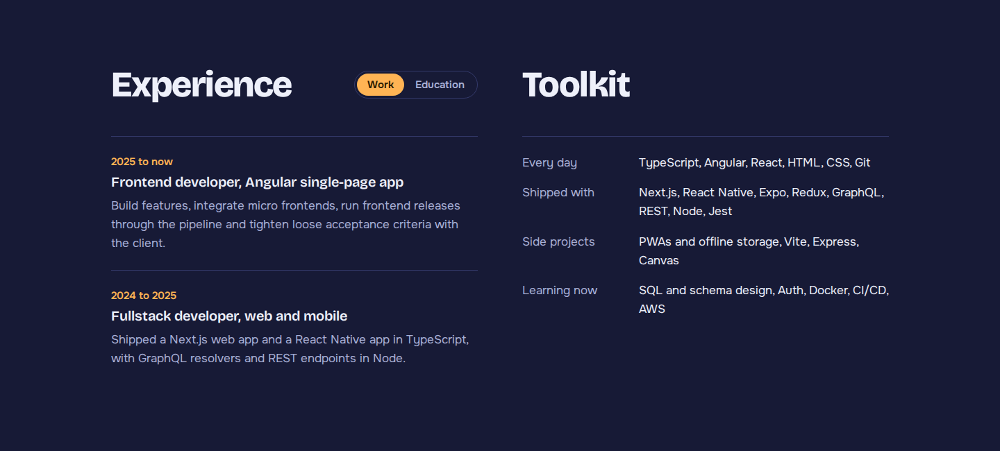
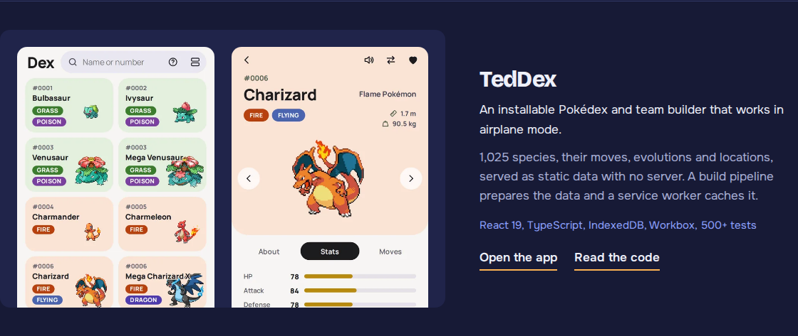
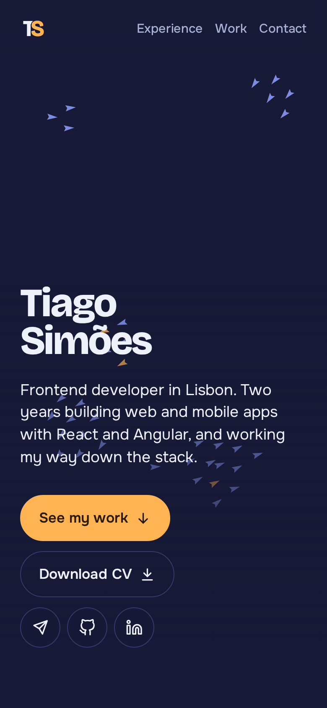

# Tiago Simões, portfolio

My developer portfolio: a single page in plain HTML, CSS and JavaScript, with no framework and no build step, plus the LaTeX source of my CV.

| Hero                                                                          | Experience                                                                 | Selected work                                                                   | Phone                                             |
| ----------------------------------------------------------------------------- | -------------------------------------------------------------------------- | ------------------------------------------------------------------------------- | ------------------------------------------------- |
|  |  |  |  |

## Features

- **Live hero:** a boids flocking simulation, adapted from my SimLab project, that flees the cursor and grows on click. It pauses off screen and shows a still frame under reduced motion.
- **Name intro:** the TS logo draws itself and turns into the name on first load.
- **Project clips:** each project plays a short muted loop over its screenshot while on screen, and opens larger in an overlay with a scrubbable player.
- **Experience tabs:** work and education share one panel with an animated, keyboard-accessible switch.
- **Contact form:** validated in the page and sent through EmailJS, with the email address as the fallback.
- **CV in two languages:** English and Portuguese PDFs built from LaTeX and served from the page.
- **Content in plain files:** projects, jobs, toolkit and contact details are edited in `content/`, without touching markup.

## Stack

HTML, CSS and JavaScript ES modules, served as static files. Fonts from Google Fonts and the contact form through EmailJS. The CV is LaTeX built with `latexmk`. The project clips are recorded with Playwright and ffmpeg.

## Engineering highlights

- **Content separate from code:** `content/` holds only data, `js/render/` turns it into DOM, and `js/features/` adds behaviour, so adding a project or reordering jobs is a one-file edit.
- **Motion that respects the visitor:** the flock and the clips pause when not visible, and one stylesheet (`css/effects/reduced-motion.css`) switches every transition off under `prefers-reduced-motion`.
- **Graceful fallbacks:** the hero name is in the HTML before the intro runs, a broken clip falls back to its screenshot, and a failed send points to the email address.
- **One-command CV:** `make` in `cv/` builds both languages and publishes the PDFs the site links to.

## Run it

Requires Python 3 (or any static file server) and a current browser. The scripts are ES modules, so serve the folder rather than opening the file:

```bash
python3 -m http.server 8000
# then open http://localhost:8000
```

| Command                                   | What it does                                                    |
| ----------------------------------------- | --------------------------------------------------------------- |
| `make -C cv`                              | Build the English and Portuguese CVs and copy them to `assets/` |
| `make -C cv clean`                        | Remove the CV build files                                       |
| `node scripts/record-clips.mjs [name...]` | Re-record the project clips from the live sites                 |

## Documentation

- [Editing content](docs/CONTENT.md): where each piece of text lives, common edits, and building the CV
- [Architecture](docs/ARCHITECTURE.md): file layout, rendering, motion, integrations and trust boundaries
- [Recording the project clips](docs/RECORDING_CLIPS.md): the recorder script, scenes and troubleshooting

## Licence and credits

No licence has been chosen, so all rights are reserved. The project screenshots and clips show my own projects. Fonts are Bricolage Grotesque and Onest from Google Fonts, under the SIL Open Font License. The CV class is based on the Medium Length Professional CV template by Trey Hunner, from LaTeXTemplates.com.
